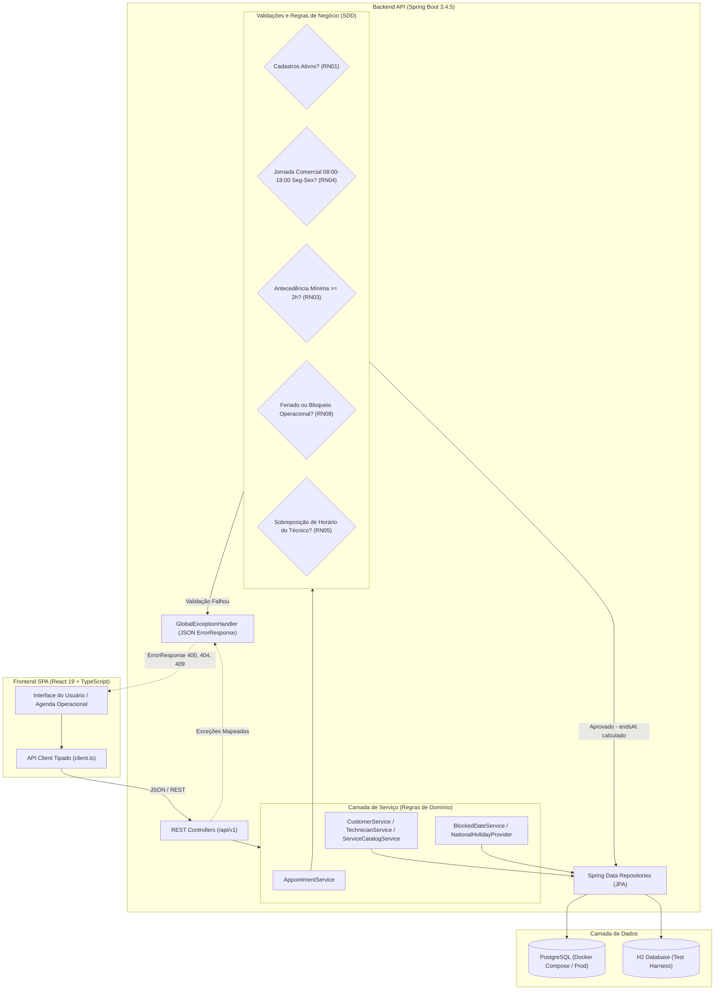
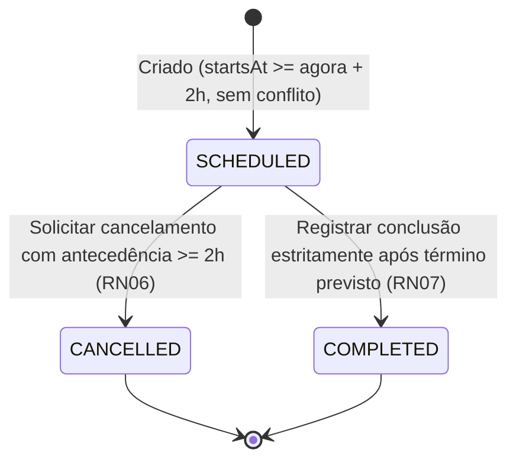

# FixTime


## Visão Geral do Projeto

O **FixTime** é uma plataforma determinística e escalável de agendamento de visitas para pequenas e médias assistências técnicas. Centraliza cadastros de clientes, técnicos e catálogo de serviços para eliminar conflitos de agenda, perda de histórico e falta de visibilidade comum em controles informais por telefone e planilhas.

O sistema permite consultar a disponibilidade técnica em tempo real, criar e listar agendamentos com filtros e paginação, cancelar visitas elegíveis, registrar conclusão pós-atendimento, bloquear feriados nacionais e exportar históricos operacionais em CSV (RFC 4180 / UTF-8 BOM).

O repositório segue rigorosamente o modelo **SDD (Spec-Driven Development)**, dividindo-se em backend Spring Boot e frontend React.

---

## Integrantes 

- Caio Boudens de Castro - RA: 22304522
- Eduardo Frois Drumond - RA: 22303035
- Fernando Medeiros Farias - RA: 22306100
- Larissa Queiroz Ramos - RA: 22304308
- Mayssa Barbosa Dias - RA: 22303603
- Thiago Venâncio Gomides - RA: 22307398

---

## Arquitetura e Fluxo da Aplicação

O sistema opera em uma arquitetura em camadas desacoplada, garantindo que o frontend seja um cliente REST estrito e que todas as regras de negócio residam exclusivamente na camada de serviço do Spring Boot.



### Ciclo de Vida do Agendamento (Transições de Status)



---

## Stack Tecnológica

- **Backend:** Java 21, Spring Boot 3.4.5, Maven, Spring Data JPA, PostgreSQL e H2 Database (testes)
- **Frontend:** React 19, TypeScript, Vite, Nginx
- **Testes & Qualidade:** JUnit 5, MockMvc, AssertJ, Vitest, Testing Library

---

## Guia de Instalação e Execução

### Pré-requisitos
- **Git** para clonagem do repositório.
- **Docker Engine 24+ e Docker Compose v2.20+** (método recomendado — não exige Java, Maven ou Node.js instalados na máquina). Verifique com `docker --version` e `docker compose version`.
- *Opcional para desenvolvimento nativo local:* JDK 21, Maven 3.9+ e Node.js 22+.

Clone o repositório:
```bash
git clone https://github.com/Fixtime-Bootcamp/bootcamp3.git
cd bootcamp3
```

---

### Variáveis de Ambiente

Antes de subir os serviços via Docker, copie os arquivos de exemplo de variáveis de
ambiente:

```bash
# Linux / macOS / Git Bash
cp .env.example .env
cp frontend/.env.example frontend/.env
```

```powershell
# Windows PowerShell
Copy-Item .env.example .env
Copy-Item frontend\.env.example frontend\.env
```

**`.env` (raiz — lido pelo `docker-compose.yml` / PostgreSQL):**

| Variável | Descrição | Valor padrão | Obrigatória |
|---|---|---|---|
| `POSTGRES_DB` | Nome do banco de dados PostgreSQL | `fixtime` | Não¹ |
| `POSTGRES_USER` | Usuário do PostgreSQL | `fixtime` | Não¹ |
| `POSTGRES_PASSWORD` | Senha do PostgreSQL | `fixtime` | Não¹ |
| `SPRING_DATASOURCE_URL` | URL JDBC usada pelo backend para conectar ao banco (execução nativa local) | `jdbc:postgresql://localhost:5432/fixtime` | Não² |
| `SPRING_DATASOURCE_USERNAME` | Usuário usado pelo backend para autenticar no banco (execução nativa local) | `fixtime` | Não² |
| `SPRING_DATASOURCE_PASSWORD` | Senha usada pelo backend para autenticar no banco (execução nativa local) | `fixtime` | Não² |

¹ `docker-compose.yml` já define esses valores como fallback (`${POSTGRES_DB:-fixtime}` etc.); o `.env` só é necessário para sobrescrever as credenciais padrão.
² Usadas apenas se você rodar o backend fora do Docker contra um PostgreSQL real; sem elas, o `mvn spring-boot:run` usa o banco H2 em memória por padrão.

**`frontend/.env` (lido pelo Vite):**

| Variável | Descrição | Valor padrão | Obrigatória |
|---|---|---|---|
| `VITE_API_URL` | URL base da API consumida pelo frontend | `/api/v1` | Não³ |

³ O proxy do Vite (`npm run dev`) e o `nginx.conf` do container já assumem `/api/v1` como padrão; só é necessário definir explicitamente se o backend estiver em outro caminho.

> ⚠️ **Atenção:** os valores de `.env.example` (incluindo usuário e senha do banco)
> são **apenas exemplos para ambiente local de desenvolvimento**. Nunca utilize essas
> credenciais padrão em homologação ou produção — defina valores próprios e seguros
> antes de qualquer deploy real.
>
> **Importante:** mantenha `VITE_API_URL` como caminho relativo (`/api/v1`). Tanto o
> `nginx.conf` do container do frontend quanto o proxy do Vite (`npm run dev`) já
> encaminham `/api/*` para o backend; apontar para uma URL absoluta
> (`http://localhost:8080/...`) faz o navegador chamar o backend diretamente,
> gerando uma requisição cross-origin que o backend rejeita (sem CORS configurado).

A **Execução Local Nativa** (sem Docker, próxima seção) não depende desses arquivos: o
backend usa o banco H2 em memória por padrão e o frontend já aponta para `/api/v1`
mesmo sem `frontend/.env`, resolvido pelo proxy do Vite em `npm run dev`.

---

### 🚀 Execução Completa com Docker (Recomendado)

Inicie toda a aplicação (Banco PostgreSQL + API Backend + SPA Frontend) com um único comando:

```bash
docker compose up --build
```

* **Frontend (React/Nginx):** `http://localhost:5173` ou `http://localhost:80`
* **Backend API (Spring Boot):** `http://localhost:8080/api/v1`
* **Documentação da API (Swagger UI):** `http://localhost:8080/swagger-ui.html` (especificação OpenAPI JSON em `http://localhost:8080/v3/api-docs`)
* **Banco PostgreSQL:** `localhost:5432`

---

### Execução Local Nativa (Alternativa)

#### 1. Backend (Spring Boot)
```bash
cd backend
mvn spring-boot:run
```
*A API estará disponível em `http://localhost:8080/api/v1` (usando banco H2 em memória por padrão).*

#### 2. Frontend (React/Vite)
Em outro terminal:
```bash
cd frontend
npm install
npm run dev
```
*A interface estará disponível em `http://localhost:5173` com proxy reverso automático para o backend.*

---

## Test Harness (Suíte de Testes Automatizados)

A suíte cobre 100% dos Requisitos Funcionais (`RF01` a `RF08`) e Regras de Negócio (`RN01` a `RN08`), com rastreabilidade formal via docstrings em cada teste.

### Executar Testes com Docker (Comando Único)
```bash
./scripts/test.sh        # Linux/macOS/Git Bash
./scripts/test.ps1       # Windows PowerShell
```
Builda e executa as suítes do backend e do frontend com cobertura, sem exigir Java, Maven ou Node.js locais, retornando código de saída diferente de zero se qualquer suíte falhar. (Preferimos esse script a `docker compose --profile test up --abort-on-container-exit`: o `up` não propaga o exit code dos containers de teste, então o script usa `docker compose run` para cada serviço e falha explicitamente.) Os relatórios ficam em `backend/target/site/jacoco/index.html` (JaCoCo) e `frontend/coverage/index.html` (Vitest/V8).

### Executar Testes Localmente

**Backend (JUnit 5 & MockMvc):**
```bash
cd backend
mvn clean test
```

**Frontend (Vitest):**
```bash
cd frontend
npm install
npm test -- --run
npm run test:coverage   # com relatório de cobertura
```

O relatório consolidado de execução do Test Harness encontra-se em [docs/test-report.md](docs/test-report.md), e o log íntegro da execução via Docker Compose está versionado em [logs_testes_final.txt](logs_testes_final.txt).

### Roteiro de Demonstração

O passo a passo do fluxo principal para apresentação e gravação do vídeo (cadastros, agendamento, conflito, cancelamento/conclusão, CSV, Swagger e testes em tempo real) está em [docs/DEMO.md](docs/DEMO.md).

---

## Troubleshooting

- **Porta já em uso (`5173`, `80`, `8080` ou `5432`):** outro processo ou container está usando a porta. Finalize-o ou altere o mapeamento de portas em `docker-compose.yml` (ex.: `"8081:8080"`).
- **Banco com dados antigos ou schema divergente:** remova o volume do PostgreSQL e recrie os containers do zero:
  ```bash
  docker compose down -v
  docker compose up --build
  ```
- **Backend não fica "healthy" / frontend não consegue falar com a API:** confira os logs com `docker compose logs backend` e valide manualmente o endpoint `http://localhost:8080/api/v1/health`.
- **Alterações no código não refletem no container:** rode `docker compose up --build` (o `--build` força a reconstrução das imagens) ou `docker compose build --no-cache` em último caso.

---

## Governança do Repositório

- Fluxo de branches: trabalho em `feature/*` → Pull Request para `develop` → merge de `develop` em `main` (branch de release).
- O workflow de CI ([.github/workflows/ci.yml](.github/workflows/ci.yml)) executa em todo `pull_request` e em pushes para `main` e `develop`, rodando as suítes de testes de backend e frontend.
- Pull Requests seguem o template em [.github/pull_request_template.md](.github/pull_request_template.md).
- **Ciclo de Vida das Branches (Limpeza Pós-Merge):** por convenção da equipe, feature branches (remota e local) são deletadas após o merge do respectivo Pull Request, para manter o repositório limpo.
- Rastreamento e divisão de tarefas documentados via **Issues** e **GitHub Projects**.

---

## Especificação Técnica (SDD)

A especificação canônica do FixTime encontra-se em [docs/SPEC.md](docs/SPEC.md) (ver também [docs/specification.md](docs/specification.md)), e o histórico evolutivo de refinamentos em [docs/spec-changelog.md](docs/spec-changelog.md).

O histórico de versões da release encontra-se em [CHANGELOG.md](CHANGELOG.md), e o relatório consolidado de testes em [docs/test-report.md](docs/test-report.md).

O ciclo de desenvolvimento segue o fluxo:  
`Specification` ➔ `Plan` ➔ `Implement` ➔ `Test` ➔ `Review`

---

## ADRs — Decisões Arquiteturais Técnicas

### ADR-001: Spring Boot e React
Escolhemos Spring Boot pela maturidade para APIs REST, validação declarativa e testes de integração. React com TypeScript e Vite oferece ciclo rápido de desenvolvimento e tipagem estática no cliente.

### ADR-002: Regras de Negócio na Camada de Serviço
Regras de conflito, horário comercial, antecedência e transição de status ficam concentradas exclusivamente na camada de serviço (`AppointmentService`). Controllers apenas validam contratos HTTP e delegam para o domínio.

### ADR-003: PostgreSQL em Produção/Compose e H2 em Testes
PostgreSQL é adotado no ambiente Docker Compose por seu suporte a transações ACID e integridade referencial. O banco em memória H2 é utilizado na execução isolada de testes para garantir velocidade e independência de infraestrutura externa.

---

## Agentes de IA

As diretrizes operacionais de assistência por IA são versionadas em [AGENTS.md](AGENTS.md), [.cursorrules](.cursorrules) e [.github/copilot-instructions.md](.github/copilot-instructions.md). O código gerado passa pela suíte de testes automatizados do CI antes do merge.

---

## 📚 Documentação e Relatórios da Entrega 3

A entrega final (release v1.0.0) reúne os seguintes documentos e evidências:

1. **[docs/test-report.md](docs/test-report.md):** Relatório Consolidado de Execução do Test Harness (152 testes automatizados — 72 backend + 80 frontend — com 100% de sucesso).
2. **Evidências de cobertura:** [docs/evidencia_jacoco.png](docs/evidencia_jacoco.png) (cobertura do backend via JaCoCo), [docs/evidencia_vitest.png](docs/evidencia_vitest.png) (cobertura do frontend via Vitest) e [docs/evidencia_resumo_testes.png](docs/evidencia_resumo_testes.png) (resumo consolidado da execução).
3. **[CHANGELOG.md](CHANGELOG.md):** histórico de versões no formato Keep a Changelog, com a seção `[1.0.0]`.
4. **Release v1.0.0:** https://github.com/Fixtime-Bootcamp/bootcamp3/releases/tag/v1.0.0 (notas também disponíveis em [docs/release-notes-v1.0.0.md](docs/release-notes-v1.0.0.md)).

### Documentação da Entrega 2 (histórico)

1. **[docs/SPEC.md](docs/SPEC.md):** Especificação Técnica Canônica do FixTime (SDD), cobrindo RF01-RF08, RN01-RN08 e contratos literais JSON.
2. **[docs/spec-changelog.md](docs/spec-changelog.md):** Histórico evolutivo dos refinamentos e decisões de modelagem.
3. **[docs/erros-logicos.md](docs/erros-logicos.md):** Inspeção de erros lógicos identificados no ciclo, estratégias de correção, ciclo de re-especificação e relato de experiência da equipe.
4. **[docs/relatorio-etico-ia.md](docs/relatorio-etico-ia.md):** Análise comparativa entre ferramentas (Claude Code, Codex, Cursor e Antigravity) e fundamentação crítica dos pilares éticos, segurança, privacidade (LGPD) e centralidade da homologação humana.
5. **[docs/relatorio-entrega-2-consolidado.md](docs/relatorio-entrega-2-consolidado.md):** Documento Consolidado da Entrega 2 para submissão oficial (disponível também em versão formatada estilizada em [docs/relatorio-entrega-2-consolidado.pdf](docs/relatorio-entrega-2-consolidado.pdf)).

